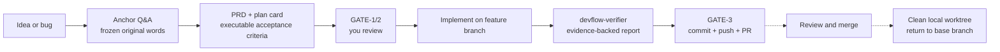

# DevFlow

**Version: 2.0.0**

English | [中文](README.zh-CN.md)

DevFlow keeps AI-assisted development honest about the three things a model cannot absorb: **your intent**, **verifiable evidence**, and **delivery authority**. The main thread does the work itself — no role-agent dispatch — while the flow anchors requirements against drift, verifies results with an independent agent, and gates every push behind your approval.



## Why DevFlow?

- **Drift-proof requirements** — your original words are frozen verbatim in the PRD; every requirement is tagged with its source (`your words` / `your answer` / `inference·confirmed`), and the PRD review shows exactly what goes beyond your words.
- **Independent verification** — a single verifier agent re-checks the work with clean context, executing every acceptance criterion as a command or evidence-backed assertion. No PASS without evidence.
- **Delivery authority stays yours** — one confirmation covers the allow-listed commit, push, and PR. PRs are never merged automatically.
- **Safe isolation** — the current demand uses a feature branch in the main workspace; a second unfinished task gets a worktree so the first one is not moved.
- **Memory across tasks** — optional Memorant integration recalls similar requirements, bugs, and decisions; every task distills its lessons.

## Quick Start

### Install for Claude Code

```text
/plugin marketplace add starme/devflow
/plugin install devflow@devflow-marketplace
```

Use `starme/devflow#main` to pin the marketplace to a branch, then restart Claude Code.

### Install for Codex CLI

```bash
npm install -g @openai/codex
```

```bash
codex plugin marketplace add starme/devflow --ref main
codex plugin add devflow@devflow-marketplace
```

Open a new Codex thread after installation.

### Start a task

In the project you want to work on:

```text
/devflow init
/devflow start "Build a team weekly report tool"
```

For a bug or maintenance change:

```text
/devflow fix "Login submission returns HTTP 500"
```

Use `/devflow status` to inspect progress. Work continues to the next gate without `/devflow next`; use `/devflow next --task <task-id>` to resume after an interrupted session or to clean up after a merged PR.

## How it works

1. **Anchor Q&A** — your original description is frozen verbatim; follow-up questions only fill gaps in the core ask (never add scope), each round shows a running summary, and model inferences must be explicitly confirmed.
2. **PRD** — a one-and-a-half-page document with per-requirement provenance; GATE-1 reviews the *drift surface* (what goes beyond your words), not the full text.
3. **Plan card** — approach, affected files, risks, and an acceptance table (`cmd` / `ai` / `manual`, each mapped to a requirement). GATE-2 approval freezes it as the definition of done.
4. **Implement** — the main thread works directly on the feature branch (a latercomer task gets a worktree; multi-repo projects create the same branch in every repository).
5. **Verify** — the `devflow-verifier` agent executes every criterion and the regression suite, producing an evidence-backed report.
6. **Deliver** — one confirmation covers the allow-listed commit, branch push, and PR creation. The verifier report and manual items are shown at the same gate.

The detailed state machine and the shortened bugfix path are in [docs/workflow.md](docs/workflow.md); the recalibration rationale is in [ADR-0005](docs/adr/0005-orchestration-recalibration.md).

### Human checkpoints

You make decisions at four points:

1. Product Q&A — clarify what to build (anchoring protocol).
2. PRD review (GATE-1) — approve the requirement set via the drift-focused view.
3. Plan card review (GATE-2) — approve the approach and the frozen acceptance criteria.
4. Delivery confirmation (GATE-3) — approve `commit + push + create PR`, with the verification report and manual acceptance items attached.

## After delivery

- Only code and explicitly listed task artifacts are committed; runtime context, audit logs, and temporary files are excluded.
- On delivery, task artifacts are archived to `.devflow/tasks/<task-id>/` (the PRD as `prd-<task-slug>.md`, other artifacts keep fixed names) so you can trace what was planned, verified, and delivered. See [the archive decision](docs/adr/0004-task-archive-convergence.md).
- PR creation pauses the task. DevFlow never merges the PR automatically.
- After the PR is merged, run `/devflow next --task <task-id>` to remove the local task worktree and local branch, keep the remote branch, and return to the task's base branch.

## Commands

| Command | Purpose |
|---------|---------|
| `/devflow init` | Detect the project and create project-level configuration. |
| `/devflow start <description>` | Start a feature: anchored Q&A → PRD → plan card → implement → verify → deliver. |
| `/devflow fix <description>` | Start a bugfix: diagnosis card → fix → regression verification → deliver. |
| `/devflow status` | Show project and task status. |
| `/devflow next --task <task-id>` | Resume the selected task or finish its delivery cleanup. |

## Supported hosts

- **Claude Code** — full adapter with hard PreToolUse file-safety protection.
- **Codex CLI** — supported adapter with soft redline protection; verify host integration before unattended execution.

See the [adapter contract](adapters/README.md) for capability boundaries and platform details.

## Security summary

DevFlow applies three safety levels:

- **Forbidden** — reads and writes are blocked for secrets and credential files.
- **Protected** — reads are allowed, but modifications require protection handling.
- **Approval required** — sensitive configuration, dependency, migration, or authentication changes require human approval.

It also enforces task directory boundaries, protects existing tests during implementation, blocks dangerous commands, and records tool activity for audit. See the project redline configuration and [architecture notes](docs/architecture.md) for details.

## Memorant (optional)

Memorant adds experience recall, bug patterns, product decisions, and distillation. DevFlow works without it; when unavailable, the lifecycle continues without memory recall.

Install Memorant separately from the [Memorant project](https://github.com/starme/memorant).

## Documentation

- [Detailed workflow](docs/workflow.md)
- [Architecture notes](docs/architecture.md)
- [Recalibration decision (ADR-0005)](docs/adr/0005-orchestration-recalibration.md)
- [Delivery lifecycle decision](docs/adr/0002-delivery-lifecycle.md)
- [Task artifact publishing decision](docs/adr/0003-task-artifact-publishing.md)
- [Adapter contract](adapters/README.md)

## Updating and uninstalling

Update the marketplace and reinstall the plugin using the host's normal plugin commands. Do not upgrade while an active task is running unless you have reviewed the release changes.

To uninstall the Claude Code marketplace installation, remove the installed marketplace through Claude Code's plugin management. Project task branches and worktrees should be cleaned through `/devflow next --task <task-id>` after their PRs are merged.
