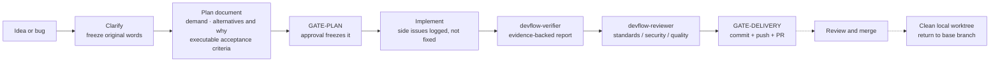

# DevFlow

**Version: 2.1.0**

English | [中文](README.zh-CN.md)

DevFlow keeps AI-assisted development honest about what a model cannot do for you: **your intent**, **verifiable evidence**, **independent review**, and **delivery authority**. The main thread does the work itself — no role-agent dispatch — and you step in at exactly two points: when the plan freezes and when the work ships.



## Why DevFlow?

- **Drift-proof requirements** — your original words are frozen verbatim; every requirement is tagged with its source (`your words` / `your answer` / `inference·confirmed`), and the review shows exactly what goes beyond your words.
- **A plan that had to compare** — the plan document must list at least two alternatives and say why each was rejected. A plan that cannot name what it rejected never compared anything.
- **Verification and review** — the verifier runs each acceptance criterion (no PASS without evidence); the reviewer reports standards, security, and quality findings with file:line. Neither one edits code.
- **Self-evolution** — lessons are recalled twice: before drafting the plan (what did we do last time?) and during development (a failing test, a verifier FAIL, a first edit, a new dependency). The same pit gets stepped in once.
- **Delivery authority stays yours** — one confirmation covers the allow-listed commit, push, and PR. PRs are never merged automatically.
- **No spread** — anything outside the plan gets logged, not fixed. You decide afterwards.

## Quick Start

### Install for Claude Code

```text
/plugin marketplace add starme/devflow
/plugin install devflow@devflow-marketplace
```

Use `starme/devflow#main` to pin the marketplace to a branch, then restart Claude Code.

### Install for Codex CLI

```bash
npm install -g @openai/codex
```

```bash
codex plugin marketplace add starme/devflow --ref main
codex plugin add devflow@devflow-marketplace
```

Open a new Codex thread after installation.

### Start a task

In the project you want to work on:

```text
/devflow init
/devflow start "Build a team weekly report tool"
```

For a bug or maintenance change:

```text
/devflow fix "Login submission returns HTTP 500"
```

Use `/devflow status` to inspect progress. Work continues to the next gate without `/devflow next`; use `/devflow next --task <task-id>` to resume after an interrupted session or to clean up after a merged PR.

## How it works

1. **Clarify** — your original description is frozen verbatim; one restatement of the core ask gets your confirmation; follow-up questions only fill gaps (never add scope), and model inferences must be explicitly confirmed.
2. **Recall at design time** — before drafting the plan, ask Memorant how this kind of demand was handled last time and which options were rejected. Each memory arrives with its trust level (verified / provisional).
3. **Plan document** — requirements with provenance, historical experience, **at least two alternatives with their rejection reasons**, and an acceptance table (`cmd` / `ai` / `manual`, each mapped to a requirement). GATE-PLAN approval freezes it as the definition of done.
4. **Implement** — the main thread works directly in the workspace (a latercomer task gets a worktree; multi-repo projects create the same branch in every repository). Anything outside the plan goes into "side issues" instead of being fixed. Recall fires again on a failing test, a verifier FAIL, a first edit, or a new dependency.
5. **Verify and review** — `devflow-verifier` executes every criterion and the regression suite with evidence; `devflow-reviewer` reports standards, security, and quality findings with file:line. Neither edits code.
6. **Deliver** — one confirmation covers the allow-listed commit, branch push, and PR creation, with the verification report, review report, manual items, and side issues shown together.

The detailed state machine and the two paths are in [docs/workflow.md](docs/workflow.md); the rationale is in [ADR-0005](docs/adr/0005-orchestration-recalibration.md) and [ADR-0006](docs/adr/0006-lean-recalibration.md).

### Human checkpoints

You make decisions at two gates:

1. **GATE-PLAN** — approve the plan document: requirements, alternatives, and acceptance criteria freeze together.
2. **GATE-DELIVERY** — approve `commit + push + create PR`, with the verification report, review report, manual acceptance items, and side issues attached.

Plus one **non-gate decision**: once the review report lands, you choose to fix or ship.

## After delivery

- Only code and explicitly listed task artifacts are committed; runtime context, audit logs, and temporary files are excluded.
- On delivery, task artifacts are archived to `.devflow/tasks/<task-id>/` (the plan as `plan.md`, other artifacts keep fixed names) so you can trace what was planned, verified, reviewed, and delivered. See [the archive decision](docs/adr/0004-task-archive-convergence.md).
- PR creation pauses the task. DevFlow never merges the PR automatically.
- After the PR is merged, run `/devflow next --task <task-id>` to remove the local task worktree and local branch, keep the remote branch, and return to the task's base branch.

## Commands

| Command | Purpose |
|---------|---------|
| `/devflow init` | Detect the project and create project-level configuration. |
| `/devflow start <description>` | Start a feature: clarify → plan document → implement → verify → review → deliver. |
| `/devflow fix <description>` | Start a bugfix: symptom and root cause fold into a slim plan document → fix → verify → review → deliver. |
| `/devflow status` | Show project and task status. |
| `/devflow next --task <task-id>` | Resume the selected task or finish its delivery cleanup. |

You do not have to type the command: "analyze this requirement and start building" or "fix this bug" is recognised, confirmed in one line, and then enters the flow.

## Supported hosts

- **Claude Code** — full adapter with hard PreToolUse file-safety protection.
- **Codex CLI** — supported adapter with soft redline protection; verify host integration before unattended execution.

See the [adapter contract](adapters/README.md) for capability boundaries and platform details.

## Security summary

DevFlow applies three safety levels:

- **Forbidden** — reads and writes are blocked for secrets and credential files.
- **Protected** — reads are allowed, but modifications require protection handling.
- **Approval required** — sensitive configuration, dependency, migration, or authentication changes require human approval.

It also enforces task directory boundaries, protects existing tests during implementation, blocks dangerous commands, and records tool activity for audit. See the project redline configuration and [architecture notes](docs/architecture.md) for details.

## Memorant (optional)

Memorant adds experience recall, bug patterns, product decisions, and distillation. DevFlow works without it; when unavailable, the lifecycle continues without memory recall.

Install Memorant separately from the [Memorant project](https://github.com/starme/memorant).

## Documentation

- [Detailed workflow](docs/workflow.md)
- [Architecture notes](docs/architecture.md)
- [Recalibration decision (ADR-0005)](docs/adr/0005-orchestration-recalibration.md)
- [Delivery lifecycle decision](docs/adr/0002-delivery-lifecycle.md)
- [Task artifact publishing decision](docs/adr/0003-task-artifact-publishing.md)
- [Adapter contract](adapters/README.md)

## Updating and uninstalling

Update the marketplace and reinstall the plugin using the host's normal plugin commands. Do not upgrade while an active task is running unless you have reviewed the release changes.

To uninstall the Claude Code marketplace installation, remove the installed marketplace through Claude Code's plugin management. Project task branches and worktrees should be cleaned through `/devflow next --task <task-id>` after their PRs are merged.
