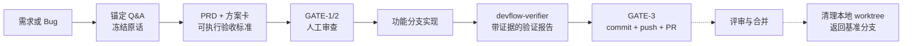

# DevFlow

**版本：2.0.0**

[English](README.md) | 中文

DevFlow 只管模型吸收不了的三件事：**你的意图**、**可验证的证据**、**交付授权**。主线程自己干活，不再按角色派发 Agent；流程负责锚定需求防漂移、用独立 Agent 验证结果、把每一次 push 守在你的确认之后。



## 为什么使用 DevFlow？

- **防漂移的需求**——你的原话逐字冻结进 PRD；每条需求标注来源（原话 / 你的回答 / 推断·已确认），PRD 审查聚焦展示"超出你原话的部分"。
- **独立验证**——唯一的 verifier Agent 以干净上下文重查实现，逐条执行验收标准（命令级 / 证据级），无证据不得标 PASS。
- **交付权在你**——一次确认覆盖白名单提交、推送和创建 PR；PR 永不自动合并。
- **安全隔离**——当前需求在主工作区功能分支上做；第二个未完成任务才进 worktree，先到的不搬家。
- **跨任务记忆**——可选的 Memorant 集成召回相似需求、bug 与决策；每个 task 结束时蒸馏经验。

## 快速开始

### Claude Code 安装

```text
/plugin marketplace add starme/devflow
/plugin install devflow@devflow-marketplace
```

如需固定 marketplace 分支，使用 `starme/devflow#main`，然后重启 Claude Code。

### Codex CLI 安装

```bash
npm install -g @openai/codex
```

```bash
codex plugin marketplace add starme/devflow --ref main
codex plugin add devflow@devflow-marketplace
```

安装后请新建 Codex thread。

### 开始任务

在要开发的项目中执行：

```text
/devflow init
/devflow start "做一个团队周报工具"
```

Bug 或维护类改动使用：

```text
/devflow fix "登录提交后返回 HTTP 500"
```

使用 `/devflow status` 查看进度。工作会干到下一个 Gate，不必打 `/devflow next`。`/devflow next --task <task-id>` 用于会话中断恢复，以及 PR 合并后的清理。

## 它如何工作

1. **锚定 Q&A**——原话逐字冻结；追问只补核心诉求的缺口（不做加法），每轮展示 running summary，模型推断必须显式确认。
2. **PRD**——一页半以内、每条需求带来源；GATE-1 审查的是"漂移面"（超出原话的部分），不是全文。
3. **方案卡**——方案要点 / 影响范围 / 风险 / 验收标准表（`cmd` / `ai` / `manual`，每条映射需求 R#）。GATE-2 批准后冻结为"怎么算做完"。
4. **实现**——主线程直接在功能分支上做（后来者 task 进 worktree；多仓库项目在每个仓库建同名分支）。
5. **验证**——`devflow-verifier` 逐条执行验收标准与回归，产出带证据的报告。
6. **交付**——一次确认覆盖白名单提交、推送和创建 PR，验证报告与 manual 项同场展示。

完整状态机和 bugfix 精简路径见 [docs/workflow.md](docs/workflow.md)；校准的决策依据见 [ADR-0005](docs/adr/0005-orchestration-recalibration.md)。

### 人工决策点

你只需要在四个节点做决策：

1. 需求澄清——锚定协议下明确要做什么。
2. PRD 评审（GATE-1）——通过漂移聚焦视图审批需求集。
3. 方案卡评审（GATE-2）——审批方案与冻结的验收标准。
4. 交付确认（GATE-3）——批准 `commit + push + create PR`，附验证报告与人工验收项。

## 交付后会发生什么？

- 只提交代码和明确列入 task 产物清单的文档；运行时上下文、审计日志和临时文件都会排除。
- 交付时，task 产物会归档到 `.devflow/tasks/<task-id>/`（PRD 发布为 `prd-<task-slug>.md`，其余保持固定名），用来追溯方案、验证与交付。详见[归档决策](docs/adr/0004-task-archive-convergence.md)。
- 创建 PR 后流程暂停，DevFlow 不会自动合并 PR。
- PR 合并后，执行 `/devflow next --task <task-id>`，删除本地 task worktree 和本地分支，保留远程分支，并返回该 task 的基准分支。
- 详细恢复规则见[交付决策](docs/adr/0002-delivery-lifecycle.md)。

## 常用命令

| 命令 | 用途 |
|------|------|
| `/devflow init` | 识别项目并创建项目级配置。 |
| `/devflow start <需求描述>` | 启动功能 task：锚定 Q&A → PRD → 方案卡 → 实现 → 验证 → 交付。 |
| `/devflow fix <描述>` | 启动 Bug 修复 task：诊断卡 → 修复 → 回归验证 → 交付。 |
| `/devflow status` | 查看项目和 task 状态。 |
| `/devflow next --task <task-id>` | 恢复指定 task 或完成交付清理。 |

## 支持的平台

- **Claude Code**——完整适配，提供 Hard 级别的 PreToolUse 文件安全防护。
- **Codex CLI**——已支持适配，红线能力为 Soft；依赖无人值守执行前请先验证宿主集成。

能力边界和平台细节见[适配器契约](adapters/README.md)。

## 安全摘要

DevFlow 提供三档安全保护：

- **禁止**——禁止读取和写入密钥、凭证等敏感文件。
- **受保护**——允许读取，但修改需要额外保护处理。
- **需审批**——敏感配置、依赖、迁移或认证代码变更需要人工审批。

此外还会执行 task 目录边界、开发期间保护已有测试、危险命令拦截和工具审计。详细说明见项目红线配置和[架构说明](docs/architecture.md)。

## Memorant（可选）

Memorant 提供经验召回、Bug 模式、产品决策和经验蒸馏。未安装 Memorant 时 DevFlow 仍可运行，只是不启用经验召回。

请从 [Memorant 项目](https://github.com/starme/memorant) 单独安装。

## 深入文档

- [完整工作流](docs/workflow.md)
- [架构说明](docs/architecture.md)
- [编排层校准决策（ADR-0005）](docs/adr/0005-orchestration-recalibration.md)
- [交付生命周期决策](docs/adr/0002-delivery-lifecycle.md)
- [Task 产物发布决策](docs/adr/0003-task-artifact-publishing.md)
- [适配器契约](adapters/README.md)

## 更新与卸载

使用宿主提供的 marketplace 命令更新并重新安装插件。活动 task 执行期间不要升级，除非已确认版本变更（v2 是破坏性升级，见 ADR-0005）。

Claude Code marketplace 的卸载请通过 Claude Code 的插件管理功能完成。task 的 PR 合并后，使用 `/devflow next --task <task-id>` 清理项目分支和 worktree。
