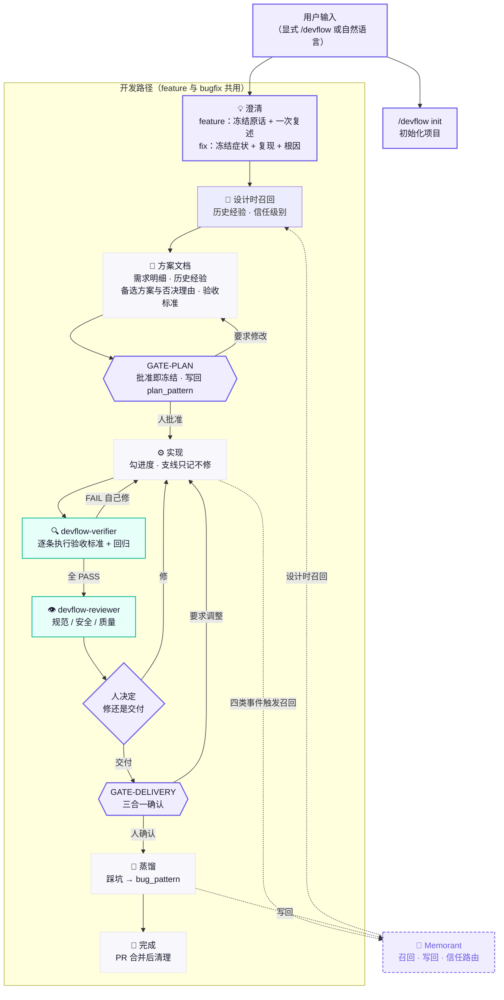

# DevFlow 工作流程详解

> 承接 README 的流程概览，补充状态机、召回、Gate 定义与两条路径的差异。
> 决策依据：[ADR-0005](adr/0005-orchestration-recalibration.md)（编排裁剪）、
> [ADR-0006](adr/0006-lean-recalibration.md)（合并 Gate、review、自然语言入口）。

## 完整工作流程图



**图例：** 紫色 = 需要人决策 ｜ 黄色 = 等人工批准的 Gate ｜ 绿色 = 独立判断的 Agent ｜ 紫色虚线 = Memorant 记忆闭环

## 状态机

`task.current_phase` 只有 5 个值，只用于提示注入，**hook 永不拦截**：

```text
qa → plan_review → working → deliver_confirm → done
```

| 值 | 含义 | 停还是干 |
|---|------|---------|
| `qa` | 需求澄清或 bug 诊断 | 与用户交互 |
| `plan_review` | GATE-PLAN 等方案文档批准 | 等用户 |
| `working` | 实现 → QA → review | 主线程连续干完 |
| `deliver_confirm` | GATE-DELIVERY 等交付确认 | 等用户 |
| `done` | PR 已合并、清理完成 | — |

旧值 `prd_review` 已退役（ADR-0006 D1），读到时按 `plan_review` 处理。
feature 与 bugfix 走同一条路径，差别只在分支前缀与方案文档是否用瘦版。

## 两条路径的差异

| | feature | bugfix |
|---|---|---|
| 分支 | `feature/<slug>-<id>` | `fix/<slug>-<id>` |
| qa | 原话 + 复述 + 填空式提问 | 症状 + 复现 + 根因 |
| 方案文档 | 完整（11 节） | 瘦版（删需求明细与核心诉求） |
| 其余 | 完全相同 | 完全相同 |

## 召回（自我进化的入口）

自我进化 = 写回 + 召回 + 迭代。写回不召回，经验是死数据；召回不写回，下次无可召回。

| | 设计时 | 开发时 |
|---|---|---|
| 时机 | 写方案文档之前 | 四类事件触发 |
| 检索词 | 核心意图 + 领域词 + 方案/选型/架构 | 错误行 / 文件名 / 依赖名 |
| 写进 | 方案文档第 4 节「历史经验」 | 方案文档第 9 节「踩坑记录」 |
| 写回 | `plan_pattern`（批准时） | `bug_pattern`（完成时） |

开发时的四个触发：测试/lint/构建失败、verifier FAIL、首次改某文件、引入新依赖。

**信任级别必须显示**：`verified` 可直接沿用，`provisional` 必须重新验证——
把被推翻的旧记忆当真理喂回去，是召回最危险的失败方式。

## 需求锚定（为什么这样设计）

漂移的三个根因，每个对应一条纪律：

| 根因 | 症状 | 对策 |
|------|------|------|
| 原话没有锚定物 | 每轮转述都是有损拷贝 | 原话逐字冻结进方案文档第 1 节 |
| 加法式提问 | "要不要也支持 X？"把没提过的种进需求 | 只做填空式提问；补充只以 `[推断]` 存在，确认前不进需求 |
| 审查面太大 | 漂移烤熟了才被看见 | 单一 GATE-PLAN 分段审查，重点看「来源 ≠ 原话的行」 |

ADR-0006 之后不再做多轮 running summary：定稿提前了一整个 Gate，漂移窗口本身变短了。

## 产物

| 产物 | 路径（task 工作区） | 归档（`.devflow/tasks/<task-id>/`） |
|------|--------------------|-----------------------------------|
| 方案文档 | `.devflow/plan.md` | `plan.md` |
| 验证报告 | `.devflow/verification-report.md` | `verification-report.md` |
| 审查报告 | `.devflow/review-report.md` | `review-report.md` |
| 交付状态 | `.devflow/delivery.yaml` | `delivery.yaml` |
| 旧任务 | `.devflow/prd.md` / `.devflow/card.md` | `prd-<slug>.md` / `card.md` |

追溯链：**原话 → 需求 R# → 验收标准 A# → verifier 证据**。

## 两个 Agent

| | `devflow-verifier`（QA） | `devflow-reviewer`（Review） |
|---|---|---|
| 问的问题 | 要求的事做了吗 | 做的这件事本身对不对 |
| 依据 | 方案文档的验收标准 | 规范 / 安全 / 质量，无预设清单 |
| 产出 | `verification-report.md` | `review-report.md`（high/medium/low） |
| 失败后 | 主线程自己修，3 轮上限 | **交用户决定修不修，不阻塞** |

## 人工介入点（2 个）

1. **GATE-PLAN**——方案文档批准：需求、备选方案、验收标准一并冻结
2. **GATE-DELIVERY**——三合一确认（commit + push + PR），附验证报告、review 报告、manual 项与待办支线

外加一个**非 Gate 的决策点**：review 报告出来后，你决定修还是直接交付。

Gate 之外的阶段由主线程连续推进，不需要打 `/devflow next`；该命令只用于中断恢复与 PR 合并后的清理。
